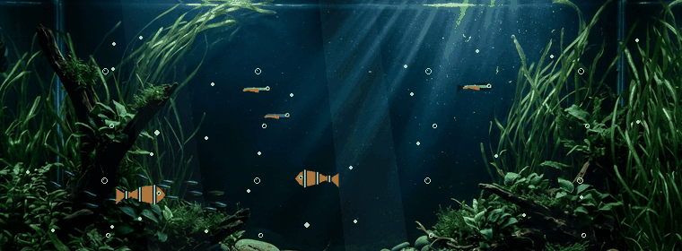

<div align="center">

# Hey, I'm Aditya 👋
### Developer | Problem Solver

</div>

<br />

### 🌊 About Me

- 🚀 Exploring **backend engineering**, **Go**, and **AI**.
- 🧠 Deepening expertise in **Data Structures and Algorithms**.
- 🌐 Passionate about **open source** and crafting robust, scalable software.

<br />

### 🛠️ Tech Stack

<div align="center">

<a href="https://go.dev" target="_blank" rel="noreferrer">
  
</a>
&nbsp;
<a href="https://www.python.org" target="_blank" rel="noreferrer">
  
</a>
&nbsp;
<a href="https://isocpp.org" target="_blank" rel="noreferrer">
  
</a>
&nbsp;
<a href="https://www.postgresql.org" target="_blank" rel="noreferrer">
  
</a>
&nbsp;
<a href="https://redis.io" target="_blank" rel="noreferrer">
  
</a>
&nbsp;
<a href="https://www.docker.com" target="_blank" rel="noreferrer">
  
</a>
&nbsp;
<a href="https://git-scm.com" target="_blank" rel="noreferrer">
  
</a>
&nbsp;
<a href="https://www.linux.org" target="_blank" rel="noreferrer">
  
</a>

</div>

<br />

### 📬 Connect With Me

<div align="center">

<a href="https://www.linkedin.com/in/adityamandre/" target="_blank" rel="noreferrer">
  
</a>
&nbsp;&nbsp;
<a href="mailto:adityamandre11@gmail.com">
  
</a>
&nbsp;&nbsp;
<a href="https://github.com/adityamandre25" target="_blank" rel="noreferrer">
  
</a>

</div>

<br />
<br />

<!-- ================= DIGITAL AQUARIUM (BOTTOM OF README) ================= -->

<div align="center">

### 🐠 Living Digital Aquarium

<a href="https://github.com/adityamandre25">
  
</a>

<sub>*A living underwater ecosystem that evolves dynamically with my merged pull request milestones.*</sub>

<br />
<br />

```
  ┌────────────────────────────────────────────────────────────────────────┐
  │                           ECOSYSTEM ROSTER                             │
  ├────────────────────────────────────────────────────────────────────────┤
  │  Tier 1 (0–5 PRs)    : Starter Shallows (Neon Tetras & Clownfish)      │
  │  Tier 2 (6–15 PRs)   : Coral Shallows (Regal Blue Tang + Growth)       │
  │  Tier 3 (16–30 PRs)  : Azure Haven (Royal Amazonian Discus Unlocked)   │
  │  Tier 4 (31–50 PRs)  : Abyssal Sanctuary (Altum Angelfish Unlocked)    │
  │  Tier 5 (51–100 PRs) : Imperial Reef (Golden Arowana & Sparkles)       │
  │  Tier 6 (100+ PRs)   : Legendary Sovereign Realm (Grand Mature Realm)  │
  └────────────────────────────────────────────────────────────────────────┘
```

<sub>Every merged pull request fuels the growth, species diversity, and visual radiance of this world.</sub>

<br />

</div>
